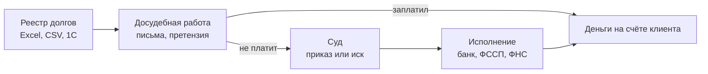
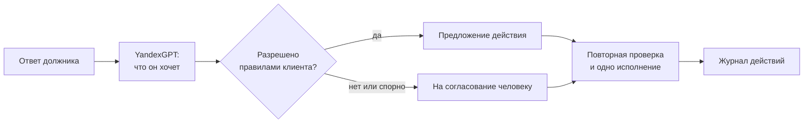
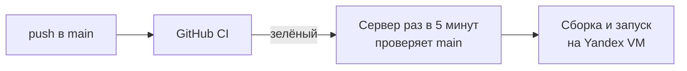

# Mandato

Сервис, который возвращает малому и среднему бизнесу деньги от покупателей, просрочивших оплату: от первого напоминания до приставов. Работает на [mandato.ru](https://mandato.ru/).

Клиент — компания, которая продаёт с отсрочкой платежа и регулярно сталкивается с просрочкой: опт, производство, логистика, подряд, B2B-услуги. Своего юриста у такой компании обычно нет.

## Как это работает



1. **Реестр.** Клиент загружает долги из Excel, CSV или 1С. Сервис проверяет должника по ИНН и показывает, хватает ли документов для суда.
2. **До суда.** Письма уходят по расписанию. Претензия выбирается по сумме долга, проценты по ст. 395 ГК считаются автоматически. ИИ читает ответы должников и отличает обещание заплатить от спора.
3. **Суд.** Сервис выбирает судебный приказ или иск, считает госпошлину и собирает пакет документов. Юрист проверяет, представитель подаёт.
4. **Исполнение.** Заявления в банк должника, приставам и в ФНС, учёт исполнительных производств. Оплаты сверяются по банковской выписке.

Деньги должника всегда идут прямо на счёт клиента, через Mandato они не проходят.

### Как работает ИИ-агент



Деньги, проценты и сроки считает код, а не ИИ. Агент действует по мандату — правилам, которые задал клиент. Сообщение «оплатили» создаёт задачу сверки, а не платёж.

## Что уже есть

| Раздел | Что умеет |
| --- | --- |
| Реестр должников | Загрузка из Excel, CSV, 1С и банковской выписки; этапы, статусы, фильтры, действия сразу по списку; архив |
| Досудебная работа | Письма по расписанию, три уровня претензии по сумме, проценты и неустойка, контроль обещаний, соглашение о погашении, акт сверки |
| ИИ | Разбор ответов должников, предложение следующего шага, остановка на согласование, журнал |
| Суд | Выбор приказа или иска, расчёт госпошлины, реестр пошлин, готовность к суду в процентах, экономика дела, срок давности |
| Документы | 33 шаблона, проверены юристом: претензии, приказ, иск, 9 ходатайств, заявления в банк, ФССП и ФНС; свои шаблоны |
| Распознавание | Судебные акты, листы и платёжки из PDF: поля, привязка к должнику, следующий шаг |
| Оплаты | Банковская выписка, распределение по счетам, частичные оплаты, возвраты |
| Аналитика | Главная с настраиваемыми графиками, свои отчёты, отчёты по расписанию |
| Команда | Несколько организаций в одном кабинете, роли руководителя и бухгалтера, приглашения |
| Сайт | Русский и английский, страница цен, заявка на демонстрацию, 14 дней бесплатно |

Тарифы: «Разовый долг» без подписки (7% с денег до суда и 9 900 / 14 900 ₽ за судебный пакет), «Бизнес» 32 900 ₽/мес и «Объём» 69 900 ₽/мес без процентов, письма и пакеты включены. Подробно — [условия оплаты](docs/payment-terms.md), [финансовая модель](docs/finance/README.md).

**Чего пока нет:** электронной подачи в суд, автоматических статусов дел, ЭДО и электронных заказных писем. Голосовые звонки и почта работают после подключения провайдера, проверка по ИНН — при подключённом ключе DaData. Биллинга нет: подключение по счёту.

## Что планируем

1. Подача в суд через «Мой арбитр» с электронной подписью и доверенностью.
2. Статусы дел из картотеки арбитражных дел без ручного ввода.
3. Электронные заказные письма Почты России: претензия и копия иска с трек-номером.
4. Документы организации (устав, доверенность) как приложения к пакетам, подпись и печать в документах.
5. Подключение почты, SMS и звонков самим клиентом, без заявки.
6. Загрузка долга сразу в исполнение и подача в ФССП через Госуслуги.
7. Финансирование долга до оплаты вместе с банком и пилот с банком-партнёром.

Сравнение с ЮРРОБОТОМ по шагам — [urrobot-workflows.md](docs/urrobot-workflows.md).

## Для разработчика

**Стек:** FastAPI (`server/`), React 19 + TypeScript + Vite (`web/`), SQLite локально и PostgreSQL на сервере, деньги в целых копейках, YandexGPT через LangGraph. Тексты на русском, английский — в `web/src/i18n/en.json`.

**Запуск** (Python 3.12, Node.js 22.12+):

```sh
python -m venv .venv && source .venv/bin/activate
python -m pip install -r requirements-dev.txt
npm ci && npm run build
cp -n .env.example .env
python -m scripts.run_local
```

Приложение откроется на <http://127.0.0.1:8000>. Секреты только в `.env`, в Git их нет. Ключи YandexGPT и прочие настройки — [агент и данные](docs/agent-runtime.md).

**Проверки перед пушем:** `python -m pytest -q`, `npx tsc --noEmit`, `npm run build`, `npx playwright test`, `npx prettier --check web/src e2e`. На Windows — [docs/testing.md](docs/testing.md).

**Деплой:**



Сервер сам забирает точный коммит из `main` после зелёного CI. Имя репозитория `Infibiss/b2b-debitorka` записано в установленном на сервере контроллере. Перед переименованием репозитория его нужно поправить, иначе деплой остановится. Подробно — [infra/yandex/README.md](infra/yandex/README.md), [эксплуатация](docs/operations.md), [архитектура](docs/architecture.md).

Прочее: [дизайн-система](docs/design-system.md), [юридические правила](docs/legal-compliance.md), [исторические отчёты](docs/archive.md).
