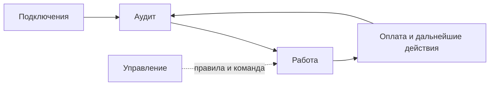

# Навигация Mandato

Четыре раздела обозначают этапы и ответственность, а не независимые приложения.

| Раздел | Назначение | Связанные действия |
| --- | --- | --- |
| Работа | Ежедневное ведение дел по контрагенту и договору, исключения, результаты и суммы портфеля | Реестр, поступления и сверка, переписка, документы и голос, разбор ответов, юридическая работа, прогноз и условия |
| Аудит | Проверка исходных данных: расхождения, документы, должник, контрольные сроки, план действий | Загрузка портфеля, ОСВ, карточка счёта, документы, проверка ИНН, переход к поступлениям или делу |
| Подключения | Доступ к источникам, чтение и просмотр полученных данных | 1С, ЭДО, банк и файл выписки, реестры, почта; инструкции IT по запросу; история у выбранного источника, партнёрский доступ к сводке |
| Управление | Политика автоматизации, роли и приглашения | Правила, команда, реквизиты и почта |

«Обзор» удалён: суммы отображаются в «Работе». Аудит сохраняется, поскольку это проверка с замечаниями, основаниями и действиями, а не только сумма задолженности.

«Операции с дебиторкой» раскрываются внутри «Работы». Карточка дела ведёт к соответствующему инструменту; вспомогательный экран имеет возврат в основной раздел. Во время обучения интерфейс остаётся доступным; кнопка «Обучение» открывает урок своего основного раздела.

Финансовые операции по-прежнему требуют существующих оснований, выбора строк и подтверждений. Перенос пунктов меню не изменяет права и бухгалтерские правила. Подключения не объявляются работающими только по наличию настроек.
