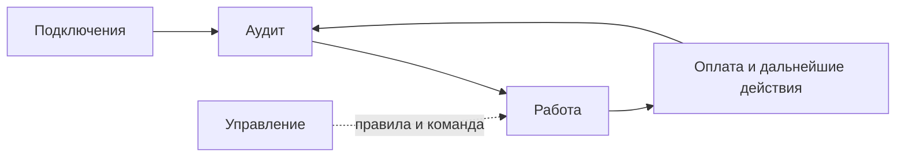

# Навигация Mandato

Четыре раздела обозначают этапы и ответственность, а не независимые приложения.

| Раздел | Назначение | Связанные действия |
| --- | --- | --- |
| Работа | Ежедневное ведение дел по контрагенту и договору, исключения, результаты и суммы портфеля | Счета, оплаты и сверка, переписка с разбором ответа, документы с разговором в браузере, претензии и суд, прогноз и условия |
| Аудит | Проверка исходных данных: расхождения, документы, должник, контрольные сроки, план действий | Загрузка портфеля, ОСВ, карточка счёта, документы, проверка ИНН, переход к поступлениям или делу |
| Подключения | Доступ к источникам, чтение и просмотр полученных данных | 1С, ЭДО, банк и файл выписки, реестры, почта; инструкции IT по запросу; история у выбранного источника, партнёрский доступ к сводке |
| Управление | Политика автоматизации, роли и приглашения | Правила и команда; реквизиты и почта доступны также из меню профиля |

«Обзор» удалён: суммы отображаются в «Работе». Аудит сохраняется, поскольку это проверка с замечаниями, основаниями и действиями, а не только сумма задолженности.

Шесть операций постоянно доступны в шапке рядом с текущим разделом, без раскрывающегося меню. «Разобрать ответ» находится в «Переписке» и доступен из дела. Карточка дела ведёт к соответствующему инструменту; вспомогательный экран имеет возврат в основной раздел.

Кнопка «Обучение» в боковой панели запускает общий обзор четырёх разделов. «Помощь по разделу» в шапке запускает локальный урок. Интерфейс остаётся доступным; подсказки расположены справа внизу. В пустом портфеле подсвечиваются кнопки загрузки, в заполненном — отдельная карточка дела.

Компания, имя и роль отображаются в профиле внизу. Нажатие открывает меню «Настройки / Выйти». Памятка о правилах закрывается крестиком, выбор сохраняется для пользователя.

Финансовые операции по-прежнему требуют существующих оснований, выбора строк и подтверждений. Перенос пунктов меню не изменяет права и бухгалтерские правила. Подключения не объявляются работающими только по наличию настроек.
