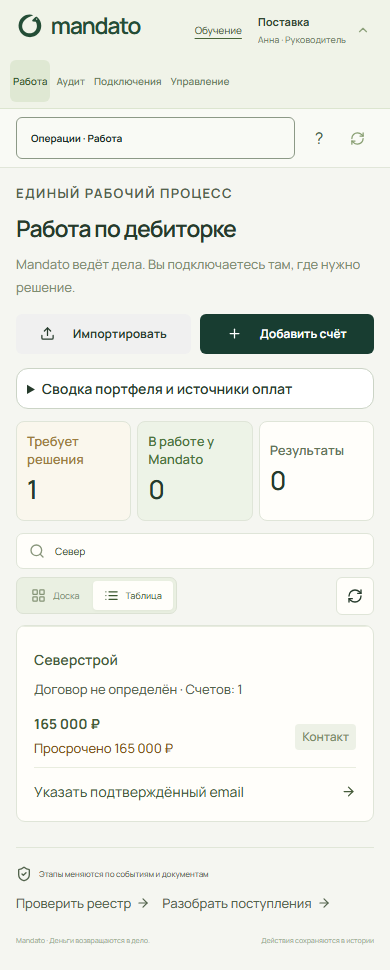

# Mandato: проблемы, исправления и проверка изменений

Дата: 29 октября 2026. База изменений: `70c2a09` (`main` до начала этой серии работ).

Выпуск объединяет приведение условий оплаты к актуальной заявке, исправление оставшихся 12 сбоев тестов и устранение 14 замечаний аудита пути клиента. Изменения проверены локально; этот отчёт не подтверждает развёртывание на рабочем сервере.

[HTML-отчёт с исходными наблюдениями и скриншотами](ui-audit-2026-10-29/index.html) можно открыть локально после клонирования. GitHub отображает HTML как исходный код; основные результаты приведены ниже. Проверки и воспроизведение описаны в [инструкции](../testing.md).

## 1. Условия оплаты расходились с актуальной заявкой

**Проблема.** Расчёт гонорара, юридические формы, лендинг и документация описывали прежнюю модель. Смешивались получатели вознаграждения, стадия взыскания и стоимость судебного пакета.

**Исправление.** Единый тариф `server/fee_tariff.json` используется сервером и интерфейсом:

- Mandato: 6% от подтверждённых поступлений после претензии и до подачи в суд.
- Судебный приказ: фикс 7 000 ₽; иск: фикс 12 000 ₽ за подготовленный и поданный пакет, независимо от результата взыскания.
- Адвокат: отдельно 12% после подачи по прямому соглашению с клиентом; эта сумма не включается в вознаграждение Mandato.

Проценты учитывают нетто банковских оплат, распределённых на соответствующий счёт. Исторические/ручные оплаты, возвраты, повторные отметки подачи и неоднозначность порядка событий в один день обработаны явно. Генерация DOCX сама по себе не создаёт фикс. Старые дела не переписываются автоматически: руководитель подтверждает новые условия. Обновлены форма, лендинг, руководство и Docker-сборка, которой теперь доступен файл тарифа.

Реализация: [legal_fees.py](../../server/legal_fees.py), [fee_tariff.json](../../server/fee_tariff.json), [pricing.ts](../../web/src/pricing.ts), [полные правила и ограничения](../payment-terms.md). Проверки: `test_legal_fees*`, `test_legal_api.py`, `e2e/legal.spec.ts`, `e2e/landing-messaging.spec.ts`.

## 2. Оставшиеся 12 сбоев тестов и проверка PostgreSQL

Сбои исходного набора были связаны с несколькими причинами; один дефект мог ломать несколько тестов.

| Причина | Исправление |
|---|---|
| Чтение UTF-8 фикстур через системную кодировку Windows | Кодировка задана явно в агентных проверках и тестах. |
| POSIX `chmod/stat` использовались как проверка приватности файла на NTFS | `scripts/private_files.py` создаёт файл с защищённой DACL владельца/SYSTEM сразу при создании; на POSIX сохраняется режим `0600`. Тесты проверяют реальные права платформы. |
| `fsync` SQLite-архива выполнялся через дескриптор только для чтения | Проверенный backup синхронизируется через дескриптор с правом записи, как требуется Windows. |
| Отказ PostgreSQL backup мог зависеть от наличия утилиты, оставлять незавершённый файл или неправильно обрабатывать существующий файл | Исключительное создание и очистка при ошибке; отказ от перезаписи. Добавлен реальный dump/restore в отдельную пустую БД. |
| Shell-тесты выбирали WSL Bash и получали несовместимые пути/переводы строк | Нативный Git Bash/MSYS2, нормализация путей и проверка UTF-8/LF; проверки SHA и CI gate сохранены. |
| Проверка запрета артефактов модели вне `var` зависела от расположения pytest temp | Для отрицательного сценария создаётся отдельный каталог заведомо вне `var`; граница проверяется независимо от `--basetemp`. |
| Сбор тестов мог захватить служебные checkout и runtime из `var` | Добавлен `pytest.ini` с явными каталогами тестов. |

PostgreSQL 17.11 запускался на отдельной локальной БД `mandato_test`, `127.0.0.1:55432`. Проверены транзакции, конкурентные операции, изоляция компаний, резервирование/восстановление, тарифы и новые UI API-контракты. После проверки временных схем `audit_*` осталось 0, кластер остановлен. Инструкция запуска находится в [docs/testing.md](../testing.md).

## 3. Аудит UI: что было и что изменено

Исходный аудит проведён 27 октября на синтетических данных; повторная проверка исправлений — 29 октября. Ниже сохранены конкретные воспроизведения, а не только названия задач.

| № | В чём была проблема | Как исправлено |
|---|---|---|
| 01 | В поле номера договора введён текст, выполнен переход «Факты → Расчёт → Факты»: поле снова пустое. Предупреждения не было. Общий индикатор «Данные сохранены» не учитывает изменения формы. Аналогичный статус виден при несохранённом редактировании реквизитов. | Черновики привязаны к пользователю и форме, переживают вкладки и обновление страницы. Ошибка сохранения их не удаляет. Файлы требуют отправки до ухода. Общий статус сообщает об обновлении данных. |
| 02 | Из дела ООО Северстрой нажата кнопка «Условия и согласования». Открывается общий экран прогноза и условий; в форме — «Выберите счёт» со всеми счетами компании. Переходы к аудиту, разбору ответов и финансам также передают только название раздела. | Счёт и дело передаются в операции. Есть возврат к делу, поиск и очередь сохраняются в URL; разрешения открываются сразу для нужного контрагента. |
| 03 | «Управление → Открыть настройки отправителя» и «Подключения → Почта → Настроить почту» приводят к реквизитам и правилам писем. Там есть статус «Не подключена», но нет настройки SMTP, заявки администратору или следующего действия. | Добавлена постоянная заявка оператору, ответственный и результат контрольной доставки. Наличие SMTP-конфигурации отличается от подтверждённой доставки. Есть возврат к рабочему делу. Для реальной отправки нужны доступы и проверка оператора. |
| 04 | На форме входа нет «Забыли пароль», самостоятельного сброса и видимого контакта поддержки. Ограничение также отражено в README. | Добавлены одноразовый сброс пароля, отзыв сессий, ограничение запросов и видимая помощь. Для доставки нужен AUTH_SMTP. Адрес поддержки оставлен заглушкой по решению владельца. |
| 05 | При открытых «Подключениях» URL остаётся /app. После обновления страницы вместо источника открылась «Работа». Выбранная юридическая вкладка и дело не представлены в URL. | Раздел, дело, счёт, юридическая и финансовая вкладки, источник и фильтры представлены в URL; обновление и история браузера сохраняют выбор. |
| 06 | После CTA «Загрузить реестр» пользователь проходит регистрацию и попадает в общий кабинет. Обучение, четыре суммы, три счётчика и линейка стадий предшествуют большому центральному блоку загрузки. Верхняя вторичная кнопка импорта доступна, но основная выделенная кнопка — «Добавить счёт». | Намерение загрузки реестра продолжается после регистрации; намерение обсудить сопровождение открывает соответствующую помощь. У пустого кабинета короткий маршрут без нулевых панелей. |
| 07 | Верхняя кнопка «Документы» открывает распознавание и учебный разговор. Регистрация первичных документов без распознавания находится в детальной форме аудита; доказательства для юридического пакета — в отдельной вкладке. | Основной экран документов — общий архив. Договор добавляется напрямую, доказательство можно явно использовать в юридическом деле. Распознавание отдельно; учебный разговор перенесён в помощь. |
| 08 | После объединения счетов по договору П-12/2026 новое юридическое дело по СЧ-102 открывается с пустым номером договора. Дело создаётся по отдельному счёту. Факты заполняются длинной формой; доказательства вводятся отдельно. | Переносится номер договора, объяснены источники реквизитов и связь требования со счётом. Факты разбиты на сохраняемые шаги, неполное заполнение допускается. Готовность оценивается по сохранённым сведениям; юридическая проверка перед выпуском сохраняется. |
| 09 | Вручную создано обещание Востока на 50 000 ₽. После заполнения формы результат требует разрешить принятие обещаний в «Оплатах и сверке» и создать новое предложение. Прямой кнопки на настройки этого контрагента нет. | Предварительная проверка полномочий видна до ввода. Адресный переход в разрешения возвращает в черновик, включая график платежей. Повторная проверка сохраняет предложение и журнал, требует нового решения и не исполняет действие автоматически. |
| 10 | «Переписка» показывает счета, которым можно написать. Для входящего ответа нужен отдельный экран «Разбор ответов», а предложения и их исполнение находятся в «Прогнозе и условиях». Без подключения обработки сообщения отказ становится явным после отправки текста. | Единая лента счёта объединяет входящие, извлечённые факты, решения, исходящие и финансовые операции. Из заявления об оплате есть переход в сверку. Доступность обработки показана заранее, исходный ответ можно перенести в ручное предложение. |
| 11 | На 390 × 844 верхняя панель с основными разделами занимает 163 px, следующая с шестью операциями — 193 px. Первая карточка дела начинается примерно на 1040 px даже после скрытия приглашения в обучение. Горизонтального переполнения в проверенных основных экранах нет. | Операции свёрнуты в меню, сводка портфеля закрыта по умолчанию, первым показан список дел. На экране 390 × 844 первая строка дела находится в пределах первого экрана. |
| 12 | В аудите пояснения к метрикам имеют размер 11 px, надпись над заголовком — 10 px; используются светлые приглушённые цвета. На рабочем столе сводка и большие счётчики занимают значительную часть первого экрана. | Пояснения в аудите увеличены до 13 px, усилен контраст, панели уменьшены. По умолчанию открывается таблица с приоритетом дел, требующих решения. Полная сертификация доступности не заявляется. |
| 13 | После импорта 150 000 ₽ исторических оплат общий показатель «Поступило» равен нулю, хотя в карточках оплаты учтены. После ввода банковской операции показатель стал 180 000 ₽. Это разный источник данных, а не ошибка арифметики. | Банковские распределения за вычетом отмен и возвратов, начальные оплаты и ручные поступления разделены. Указан период — всё время учёта. Нулевой остаток и поступления не приписываются автоматически результату взыскания Mandato. |
| 14 | Кнопка «Помощь по разделу» вызывает setTab(parentSection(tab)): из финансов, юридической работы и документов пользователь возвращается в общий родительский раздел. Текущая форма может быть размонтирована. | Контекстная помощь открывается поверх текущей формы и сохраняет URL. Общий обзор доступен отдельной командой, возврат фокуса не прокручивает форму. |

Основные изменения находятся в `navigation.tsx`, `useFormDraft.ts`, `Workspace.tsx`, `WorkflowDesk.tsx`, `LegalDesk.tsx`, `IntelligenceDesk.tsx`, `FinanceDesk.tsx`, `CaseConversation.tsx`, `DocumentsDesk.tsx`, `ContextHelp.tsx`, `MailSetup.tsx` и `AccountHelp.tsx`.

Серверные части: `account_help.py` (восстановление и заявки), `portfolio.py` (архив), `workflow.py` (единая история), `negotiation.py` (предварительная и повторная проверка), `main.py` (источники оплат). Новые пути сохраняют проверку компании, полномочий и финансового состояния. Повторная проверка предложения не исполняет его автоматически; недостаточные юридические факты можно сохранить, но они блокируют выпуск неподготовленного пакета.

## 4. Результаты проверки

| Проверка | Результат | Подтверждение |
|---|---|---|
| Полный серверный набор с подключённой тестовой PostgreSQL | **548 passed, 1 skipped**, 230,89 с | [Лог](ui-audit-2026-10-29/verification/pytest.txt) |
| Проверки, связанные с PostgreSQL, внутри полного набора | **29**, без сбоев | `tests/*postgres*`, `tests/test_storage_pg.py`; также связанные интеграционные сценарии в полном наборе |
| Полный браузерный набор, desktop + mobile | **106 passed**, 5,2 мин | [Лог](ui-audit-2026-10-29/verification/playwright-final.txt) |
| После финального уточнения шрифта и контраста | **4 passed**: очередь и узкие/промежуточные размеры | [Лог](ui-audit-2026-10-29/verification/visual-check.txt) |
| TypeScript, Vite build, `git diff --check` | Успешно | [Сводка](ui-audit-2026-10-29/verification/results.json) |

Единственный пропуск — отдельно включаемый тест платного live-провайдера Yandex. Vite сообщает о крупном JS chunk; сборка завершается успешно. Проверки не заменяют полный аудит доступности или испытание реальных внешних каналов.

Новые регрессии: `tests/test_account_help*.py`, `tests/test_ui_audit_*.py`, `tests/test_private_files.py`, `e2e/ux-repairs.spec.ts`, `e2e/audit-followup.spec.ts`. Проверялись потеря/восстановление черновика, отказ сохранения и недоступность хранилища, одноразовый сброс пароля и отзыв сессий, изоляция компаний, просроченные полномочия и предложения, изменение остатка, восстановление URL и перенос контекста.

### Мобильный экран после исправлений

На 390 × 844 первое дело видно без прокрутки; раньше оно начиналось примерно на 1040 px. Сводка сворачивается, операции находятся в меню, основной вид — таблица приоритетных дел.

## 5. Что требует настройки при запуске

- Реальная отправка писем требует SMTP и привязки к организации. Заявка хранится в БД; администратор назначает ответственного и отдельно подтверждает контрольную доставку. Автоматическая пересылка заявки во внешний helpdesk не реализована.
- Восстановлению пароля нужна сервисная почта `AUTH_SMTP_*` и корректный `APP_URL`.
- `SUPPORT_EMAIL` оставлен пустым по решению владельца; интерфейс показывает заглушку.
- Банк, 1С, ЭДО и обработка сообщений требуют реальных доступов и отдельной проверки. Во время регрессий реальные письма и платные внешние вызовы не выполнялись.
- Черновики живут в текущей вкладке браузера; файлы не сохраняются в `sessionStorage`. Пользователь видит это ограничение и предупреждение перед уходом с неотправленным файлом.
- В этой серии не менялась модель «одно юридическое дело на счёт». Интерфейс объясняет отличие от рабочего дела по договору.

Практический маршрут клиента описан в [первом рабочем дне](../first-working-day.md); эксплуатационные параметры и команды оператора — в [README](../../README.md).
