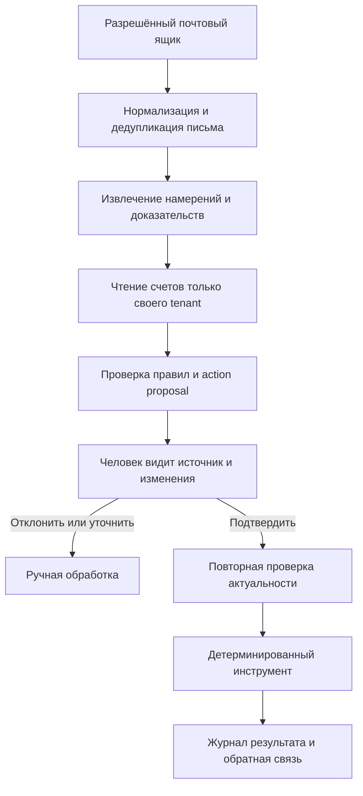

# Mandato: первый агент, LangGraph/LangChain/Langfuse и голосовые звонки Yandex

Дата проверки: **2026-10-24**. Контекст: B2B-дебиторская задолженность российских компаний. Это исследование и предложение следующего этапа, **не описание уже внедрённого агента**. Код приложения не менялся, платные API и реальные звонки не запускались. Файл `.env`, секреты и права существующего ключа не исследовались.

**Факт** ниже означает подтверждённую возможность по официальной документации; **рекомендация** — проектное решение для Mandato; **целевой порог** — ещё не достигнутый критерий пилота. Уверенность высокая в различиях продуктов и описанных API, средняя в выборе конкретной схемы до испытаний на письмах заказчика. Экономический эффект и законность конкретного обзвона этим исследованием не установлены.

## 1. Решение для следующего этапа

**Рекомендация:** первым сделать ограниченного помощника по входящим письмам. Он извлекает обещание оплаты, спор, заявление «мы оплатили», запрос документа или отказ от контакта; читает разрешённые данные нужного счёта; предлагает проверяемое действие. Сотрудник видит источник и точные изменения, подтверждает их, после чего действие выполняет обычный серверный инструмент. Голос — следующий отдельный эксперимент после проверки этой цепочки.

Ценность — сокращение времени разбора ответов и пропущенных договорённостей. LangGraph не делает расчёты денег точнее сам по себе; Langfuse не обеспечивает право отправить письмо; LLM не подтверждает банковское поступление. Уже реализованная генерация общих фраз — узкая функция текста. Она не равна агенту с входящими событиями, инструментами, сохранённым состоянием и контролируемым выполнением.

**Факт о конкуренции:** Chaser публично предлагает распознавание намерения входящего ответа, включая promise-to-pay, спор и запрос документа, и редактируемый AI-черновик. Upflow перечисляет Collections Agent, AP Portal Agent и Cash Application Agent в своём предложении. Это подтверждает наличие заявленных функций категории, но не их точность или фактическую автономность. [Chaser](https://www.chaserhq.com/features/ai-email-generator), [Upflow](https://upflow.io/pricing).

**Вывод:** обещание «у нас AI-агент, которого нет у конкурентов» не обосновано. Возможное преимущество нужно проверять в подключении российских учётных систем, качестве сверки, русскоязычных рабочих сценариях, журнале согласований и времени ежедневной работы. Выбор фреймворка сам по себе таким преимуществом не является.

## 2. LangGraph и LangChain с Langfuse: это разные слои

| Слой | Подтверждённая функция | Что реально улучшит в Mandato | Что остаётся нашей задачей |
|---|---|---|---|
| LangChain `create_agent` | Цикл модель → инструменты, middleware, общий интерфейс моделей. Современные агенты LangChain построены на LangGraph | Быстро собрать ограниченный цикл чтения данных и формирования предложения | Доступность нужного Yandex API через выбранный адаптер, схемы аргументов, права, лимиты и обработка ошибок |
| LangGraph | Явный граф шагов, состояние потока, checkpoints, остановка и возобновление | Пауза на часы до согласования, восстановление после сбоя, контролируемые ветки «спор/обещание/неясно» | Запуск worker, очередь, миграции, хранение, изоляция арендаторов, идемпотентность внешних действий |
| Langfuse | Трассы модели/инструментов, стоимость/задержки, оценки и эксперименты | Находить ошибки извлечения и дорогие циклы, сравнивать версии prompt/model, собирать обратную связь | Бизнес-согласование, выполнение инструмента и достоверный учёт долга |

Источники фактов таблицы: [LangChain overview](https://docs.langchain.com/oss/python/langchain/overview), [LangGraph persistence](https://docs.langchain.com/oss/python/langgraph/persistence), [интеграция Langfuse с LangChain и LangGraph](https://langfuse.com/integrations/frameworks/langchain).

**Вывод:** «LangGraph против LangChain + Langfuse» — неточное сравнение. Можно использовать явный LangGraph с несколькими модельными узлами и Langfuse; можно начать с LangChain `create_agent`, который уже использует LangGraph. Для первого линейного сценария допустим и обычный Python workflow с таблицей предложений. Добавлять LangGraph стоит, когда нужны реальные длительные ожидания, повторные запуски и ветвления, а не ради названия «агент».

### Состояние и durable execution

**Факт:** checkpointer сохраняет состояние отдельного `thread_id`; store предназначен для данных между потоками. InMemorySaver теряет состояние при перезапуске. Документация предлагает постоянный checkpointer для production; SQLite saver описан для локальной разработки, PostgreSQL saver — для постоянного хранения с async. Автоматическая инфраструктура persistence в Agent Server — отдельная возможность сервера, не результат одного импорта OSS-библиотеки. [Persistence](https://docs.langchain.com/oss/python/langgraph/persistence).

**Рекомендация:** для эксперимента допустим отдельный локальный checkpoint-файл на синтетике. До работы с клиентскими письмами определить постоянное хранилище, восстановление worker и резервные копии. Источник истины для счетов, согласований и исполнений — бизнес-БД Mandato. Состояние LLM-графа не должно становиться вторым независимым реестром остатков. Не сохранять в checkpoint весь почтовый ящик.

### Human approval и повторное выполнение

**Факт:** `interrupt()` сохраняет checkpoint и приостанавливает граф; продолжение выполняется через `Command(resume=...)` с тем же `thread_id`. При возобновлении узел начинает выполняться заново, поэтому побочные эффекты перед interrupt должны быть идемпотентными. Middleware LangChain умеет approve/edit/reject/respond; `respond` подставляет результат инструмента и не является запретом опасного действия. [LangGraph interrupts](https://docs.langchain.com/oss/python/langgraph/interrupts), [LangChain human-in-the-loop](https://docs.langchain.com/oss/python/langchain/human-in-the-loop).

**Вывод:** checkpoint даёт восстановление вычисления, но не гарантирует единственную отправку SMTP и не удостоверяет личность согласовавшего. Подтверждение нужно хранить на сервере с пользователем, версией предложения и сроком действия. Повторный resume, рестарт worker и повторная доставка события должны быть безопасны на уровне конкретного инструмента. После редактирования предложения требуется подтверждение его окончательных аргументов.

## 3. Архитектура первого реального агента

Это **предлагаемая архитектура**, а не текущие endpoints или таблицы приложения.

### Входящее событие и извлечение

1. **Почта:** нужен отдельный входящий connector с доступом к согласованному ящику/папке через API или IMAP. SMTP уже решает отправку и сам по себе не читает ответы. Дедупликация по ID провайдера и Message-ID с tenant; повторное уведомление не создаёт повторное действие. Сохранять время получения и исходный источник. Автор письма и цитата в теле не являются авторизацией на изменение счёта.
2. **Нормализация:** ограничить размер, отделять новый ответ от истории и подписи; безопасно превращать HTML в текст. Вложения — отдельный разрешённый обработчик; URL из письма автоматически не открывать. Содержимое письма считать недоверенным, включая «игнорируй правила», инструкции вызвать API и подмену реквизитов.
3. **Результат модели:** один или несколько типов `promise`, `dispute`, `payment_claim`, `document_request`, `opt_out`, `unknown`. Для каждого — цитата-доказательство, ссылки на сообщение, кандидаты счетов, явно указанная сумма/валюта/дата, неоднозначности. Неизвестное значение — `null`, а не догадка. «Завтра» разрешать относительно времени письма и `APP_TIMEZONE`, показывать исходное выражение и полученную дату.
4. **Связывание:** искать счёт только в tenant отправившего запрос сотрудника/подключённого ящика. Совпадение e-mail или названия не достаточно для надёжной идентификации юридического лица. При нескольких счетах, общей бухгалтерии группы компаний или пересылке — очередь ручного разбора.

**Особое правило:** «Оплатили вчера» означает `payment_claim`, а не подтверждённый платёж. Модель может предложить задачу сверки, но не уменьшает остаток. Поступление подтверждается согласованным источником учёта/банком и распределением по счетам либо уполномоченным сотрудником. Обещание оплаты и спор также не должны автоматически становиться юридическим признанием долга или изменением договора.

### Проверяемое предложение

У предложения должны быть: `tenant_id`, исходное сообщение, конкретный `invoice_id`, тип инструмента из allowlist, типизированные аргументы, доказательства, исходные версии счёта/контакта и остаток на момент предложения, версия prompt/model, срок действия, ключ идемпотентности, ожидаемое изменение и состояние исполнения. В интерфейсе показывать «было → станет» и действие, которое действительно произойдёт.

Предлагаемый начальный набор инструментов: поиск кандидатов счёта; чтение текущего счёта; создание предложения обещания; предложение паузы/спора; создание черновика ответа; создание задачи сверки оплаты. Ограничить цикл, например тремя обращениями за дополнительными данными, затем `unknown` и ручная обработка. Произвольные SQL, shell, URL и полный CRM/MCP с правами записи агенту не нужны.

После подтверждения сервер снова проверяет tenant, полномочия, версии, текущий остаток, спор/паузу, адресата и устаревание источника. Изменившиеся данные отменяют старое подтверждение. Письмо или звонок исполняются через существующие ограничения частоты и согласований; изменения доменной модели — через проверяемую транзакцию. Для внешней доставки нужна очередь/outbox и журнал попыток. Потеря ответа SMTP после фактической отправки требует состояния «результат неизвестен» и сверки, а не обещания exactly-once.

**Рекомендация по агентности:** модель может выбирать следующий разрешённый инструмент чтения и вид предложения. Она не выбирает арендатора, не выдаёт себе права и не отменяет проверки. Такой ограниченный цикл добавляет работу с контекстом; если он не превосходит линейное извлечение по метрикам, оставить более простой workflow.

## 4. Evals: что докажет полезность

**Факт:** Langfuse поддерживает оценку live traces и заранее определённых datasets, ручную разметку, автоматические оценки и сравнение экспериментов. Их можно использовать как regression gate в CI. Наличие dashboard не заменяет качество эталонной разметки. [Langfuse evaluation](https://langfuse.com/docs/evaluation/overview).

**Предлагаемый набор:** сначала 100–200 разрешённых и минимизированных примеров с двойной разметкой и разрешением разногласий. Включить русские относительные даты, отрицание («не обещали»), старую цитату с уже исполненным обещанием, несколько счетов, частичную оплату, спор, заявление об оплате, чужой счёт, пересланное письмо, подмену получателя и prompt injection. Не допускать пересечения тредов между примерами для настройки и закрытым тестом; отдельно проверять новых контрагентов. Не выбирать prompt по закрытому тесту. Эти объёмы — начало проверки, не статистическое доказательство надёжности.

| Проверка | Предлагаемый критерий допуска |
|---|---|
| Намерение, сумма, дата, счёт | Отдельные precision/recall и exact match по полям; разбор ошибок человеком |
| Предложение без выдуманных фактов | ≥95% precision среди предложений, допущенных к показу как готовые; обязательно отдельно показать долю отказов/ручных случаев |
| Доказательства | У каждого существенного извлечённого поля есть проверяемая цитата или оно помечено как неизвестное |
| Изоляция и управление действиями | 0 операций чужого tenant, 0 внешних действий без нужного подтверждения, 0 автоматических зачётов `payment_claim` в тестах |
| Сбои | Повтор события, двойной approve/resume, рестарт, таймаут инструмента и устаревший контакт не дают двойного изменения или слепой повторной отправки |
| Польза | Целевая гипотеза: медианное время разбора ответа меньше исходного хотя бы на 30%, при сопоставимом составе писем и без роста критических ошибок |
| Эксплуатация | Измерены p50/p95 задержки, стоимость на письмо и число вызовов; настроен лимит стоимости/шагов, таймаут и ручной fallback |

Все числа таблицы — **целевые пороги**, результатов пилота пока нет. Нулевые ошибки в тестах не доказывают нулевой риск вне выборки. Деньги, tenant, факт согласования и исполнение проверять кодом. LLM-as-judge использовать как дополнительную оценку понятности/тона после сопоставления с оценками сотрудников, не как арбитра оплаты. Изменение модели или prompt прогонять на том же закрытом наборе; сохранять версию и возможность отката.

## 5. Langfuse: стоимость, самостоятельное размещение и персональные данные

**Факт:** текущая документация самостоятельного размещения Langfuse v4 описывает web и worker, PostgreSQL, ClickHouse, Redis/Valkey и S3/blob storage; отдельным функциям нужен LLM API. Docker Compose предназначен для локальных испытаний и сам по себе не даёт HA, масштабирование и резервные копии. Часть возможностей лицензируется отдельно. [Self-hosting](https://langfuse.com/self-hosting).

**Вывод:** «open source» не означает нулевые расходы. В смету входят серверы, диски/blob, резервные копии, обновления, доступы и работа оператора. Для первого локального пилота можно начать с минимизированного журнала решений и воспроизводимого eval-скрипта; подключать Langfuse, когда ценность поиска по трассам и сравнения версий оправдает отдельный контур. GPU для вызовов внешней модели и такого workflow не требуется; своё обучение/инференс пока не обоснованы.

**Факт:** клиентское маскирование Langfuse происходит до передачи. Server-side ingestion masking — EE-функция: событие сначала попадает в blob storage, затем маскируется worker перед ClickHouse. По умолчанию ошибка callback допускает обработку без маскирования; есть режим fail-closed. Поэтому серверное маскирование не гарантирует, что сырой текст не покинул приложение. [Data masking](https://langfuse.com/self-hosting/security/data-masking).

**Рекомендация:** клиентское удаление чувствительных полей до любого egress, allowlist полей trace, случайные/псевдонимизированные идентификаторы, короткая согласованная retention. Не отправлять в Langfuse сырые письма, телефонные номера, банковские документы, секреты инструментов и аудио «на всякий случай». Доказательства хранить в защищённом контуре Mandato; trace связывать с ними внутренним ID. Нужна отдельная проверка удаления из blob, БД, checkpoint и резервных копий.

**Факт:** self-hosting не равен автоматическому отсутствию внешних соединений: документация hardening описывает telemetry и способы её отключения, а часть возможностей может обращаться к внешнему LLM. Проверять текущую лицензию и сетевую конфигурацию. [Langfuse hardening](https://langfuse.com/self-hosting/configuration/hardening).

Для реальных данных российских клиентов размещение, договоры обработки, доступы и трансграничные потоки нужно утвердить до подключения. Сначала синтетика/согласованное обезличивание; затем отдельный разрешённый контур в РФ. Самостоятельный Langfuse в РФ уменьшает один внешний поток, но не меняет местонахождение API модели и не является юридической гарантией соответствия.

## 6. Что у Yandex действительно есть для голосовых разговоров

| Продукт | Подтверждённая возможность | Чего он сам по себе не закрывает |
|---|---|---|
| SpeechKit STT/TTS | Распознавание речи и озвучивание заданного текста | Диалоговая бизнес-логика, исходящий вызов в телефонную сеть, номер оператора |
| AI Studio Realtime / голосовой агент | Двусторонний WebSocket для аудио/текста, контекст соединения, function calling; можно создать и проверить через UI | Долговременное бизнес-состояние, платёжная сверка, права инструмента, готовый исходящий PSTN dialer |
| SpeechKit Brand Voice | Собственный голос синтеза, обученный на разрешённых записях | Управление диалогом, выбор адресата, телефония |
| SpeechSense | Анализ загруженных разговоров и текстов, поиск, теги, оценка/сводки | Установление исходящего разговора и управление живым аудиоканалом |
| Оператор, АТС, интегратор | Номер, SIP/PSTN, маршрутизация, при необходимости готовая роботизированная платформа | Не подтверждает правильность долга и не заменяет согласования Mandato |

Факты таблицы: [Realtime](https://aistudio.yandex.ru/ru/docs/ai-studio/concepts/agents/realtime), [SpeechKit и телефония](https://aistudio.yandex.ru/ru/docs/speechkit/concepts/ivr-integration), [Brand Voice Lite](https://aistudio.yandex.ru/ru/docs/speechkit/tts/brand-voice/bv-lite), [SpeechSense](https://aistudio.yandex.ru/ru/solutions/speechsense).

**Факт:** отдельная страница SpeechKit прямо говорит об отсутствии готового решения интеграции телефонии и перечисляет партнёров/MRCP-подход. При этом у AI Studio уже есть официальная инструкция Realtime ↔ FreePBX/Asterisk через собственный программный мост. Она описывает входящий/внутренний вызов: RTP у АТС и PCM/WebSocket у Realtime несовместимы напрямую. Это пользовательский пример, опубликованный в официальной документации, а не управляемый сервис исходящего обзвона. [Интеграция SpeechKit](https://aistudio.yandex.ru/ru/docs/speechkit/concepts/ivr-integration), [Asterisk tutorial](https://aistudio.yandex.ru/ru/docs/ai-studio/operations/agents/voice-agent-asterisk-integration).

**Вывод:** варианты пилота — своя АТС/мост или интегратор/телефонная платформа, у которой подтверждены исходящие вызовы и нужный медиадоступ. В обоих случаях нужны договор/номер оператора, исходящий маршрут, caller ID/маркировка, обработка статусов и завершение оплачиваемой сессии. Ни Yandex ID, ни один API-ключ AI Studio не предоставляют телефонный номер и оплаченный SIP-транк.

**Факт:** контекст Realtime живёт до закрытия WebSocket; следующее соединение создаёт новую сессию. Модель возвращает имя функции и аргументы, исполнение делает клиент. Документация рекомендует не более восьми функций и описывает MCP approval policy. [Realtime](https://aistudio.yandex.ru/ru/docs/ai-studio/concepts/agents/realtime).

**Рекомендация:** не подключать агенту полный MCP с правами CRM/оплат. Только узкие функции чтения разрешённых данных и создания предложения. `require_approval` протокола — дополнительная мера, бизнес-решение подтверждается авторизованным сотрудником в Mandato.

**Текущая доступность:** страница Brand Voice Lite на дату проверки показывает предупреждение, что функциональность отключена из-за инцидента. Это не доказывает недоступность всех продуктов Brand Voice. Для пилота использовать стандартный голос; возобновление Lite и условия других вариантов уточнять у Yandex. Собственный голос требует согласия владельца голоса и подготовки датасета. [Brand Voice Lite](https://aistudio.yandex.ru/ru/docs/speechkit/tts/brand-voice/bv-lite).

## 7. Ключи, IAM, scopes: нужен ли второй ключ

**Короткий ответ:** отдельный «ключ для звонков» не является универсальным техническим требованием. Один сервисный аккаунт и подходящий ключ могут обслуживать текстовые и речевые API. Доступ определяется **ролью аккаунта на нужном ресурсе + областью действия ключа + выбранным API**, а не названием переменной `.env`. Существующий ключ может быть слишком узким, истёкшим или привязанным к другому каталогу; его работоспособность не проверялась.

| Задача | Что проверять в доступе |
|---|---|
| Текущий Text Generation API | Роль `ai.languageModels.user` или достаточная более широкая; scope `yc.ai.languageModels.execute` либо подходящий агрегированный scope |
| Прямой SpeechKit STT/TTS | Роли `ai.speechkit-stt.user` / `ai.speechkit-tts.user`; scopes `yc.ai.speechkitStt.execute` / `yc.ai.speechkitTts.execute` либо агрегированный доступ |
| **Новый Realtime** | Текущая инструкция требует **`ai.models.user` и `yc.ai.foundationModels.execute`**; folder ID входит в URI модели |
| SpeechSense, если он понадобится отдельно | Scope **`yc.speech-sense.use`**, членство/роль в пространстве; для загрузки диалогов `speech-sense.data.editor`. Это не тот же API, что STT/TTS |

Источники: [роли AI Studio](https://aistudio.yandex.ru/ru/docs/ai-studio/security/), [области действия IAM API key](https://yandex.cloud/ru/docs/iam/concepts/authorization/api-key), [требования Realtime](https://aistudio.yandex.ru/ru/docs/ai-studio/operations/agents/create-voice-agent), [SpeechSense auth](https://aistudio.yandex.ru/ru/docs/speechsense/api-ref/authentication), [официальный SpeechSense tutorial с ролью Data editor](https://yandex.cloud/ru/docs/tutorials/ml-ai/speechsense/ai-assistant).

**Неоднозначность документации:** Realtime tutorial и Asterisk tutorial требуют `yc.ai.foundationModels.execute` и говорят, что ключ мастера AI Studio подходит. Но таблица scopes самого мастера перечисляет text/STT/TTS и другие отдельные scopes, не показывая агрегированный foundationModels. Поэтому нельзя гарантировать совместимость любого уже выданного «AI Studio key» только по этой таблице. Для нового тестового Realtime-ключа следовать явным требованиям Realtime, проверить метаданные без вывода секрета и короткий canary на синтетике; спорный случай уточнить у поддержки. [Мастер ключей](https://aistudio.yandex.ru/ru/docs/ai-studio/operations/get-api-key), [Realtime auth requirements](https://aistudio.yandex.ru/ru/docs/ai-studio/operations/agents/create-voice-agent).

**Факт:** SpeechKit для сервисного аккаунта поддерживает IAM bearer token или `Authorization: Api-Key …`; каталог берётся из аккаунта, и передавать folder ID в прямом SpeechKit-запросе не нужно. Для пользовательского IAM действуют другие правила folderId/x-folder-id в зависимости от версии API. Это не отменяет folder ID в `gpt://…` URI Realtime. [SpeechKit authentication](https://aistudio.yandex.ru/ru/docs/speechkit/concepts/auth).

**Рекомендация:** для эксплуатации разделить text и voice сервисные аккаунты/ключи ради минимальных прав, независимого отзыва и учёта затрат. Это наше решение по эксплуатации, не обязательное требование покупать второй продукт. Не давать runtime `admin`/`editor` ради быстрого исправления 403. Различать Yandex ID пользователя, ID сервисного аккаунта, ID ключа, секрет ключа, cloud ID и folder ID. Секрет не нужен в чате; оператор проверяет роли/scopes/срок в консоли.

## 8. Голосовой пилот: схема, стоимость и ограничения

**Предлагаемая схема:** сотрудник согласует конкретный звонок → сервер проверяет адресата/актуальность/разрешения → оператор/АТС устанавливает вызов → медиамост соединяет разговор с Realtime → агент ведёт ограниченный диалог → возможные обещание/спор/заявление об оплате попадают в ту же очередь предложений → сотрудник проверяет результат. Передать договорённость человеку или закончить разговор должно быть штатным исходом.

Для более строгого контроля озвучиваемых сумм можно испытать раздельный вариант SpeechKit STT → ограниченный текстовый workflow → проверенный текст → SpeechKit TTS. В Realtime свободный аудиоответ может уйти до постпроверки полной фразы: prompt не гарантирует точное произнесение суммы и отсутствие лишнего обещания. Поэтому сначала синтетика и собственные номера, затем сравнение управляемости, задержки и качества. Не обещать «живой разговор без задержек» до замеров на реальном телефонном канале.

Технические проверки: кодек и частота PCM/телефонного канала, перепаковка RTP, двусторонний звук, эхо и перебивание, тишина/автоответчик/неверный адресат, обрыв WebSocket, отсутствие ответа инструмента, перевод человеку, лимит длительности и прекращение тарификации после hangup. Официальный Asterisk пример использует ARI External Media в Asterisk 16.6+, отмечая AudioSocket с версии 18; вариант развёртывания и кодек нужно сверить со своей АТС. [Asterisk integration](https://aistudio.yandex.ru/ru/docs/ai-studio/operations/agents/voice-agent-asterisk-integration).

**Факт о квотах:** текущая общая таблица AI Studio указывает 10 одновременных Realtime-сессий и 10 запросов создания сессии в секунду; квоты можно запрашивать к увеличению. Это не разрешение на такой объём обзвона и не SLA. Перед пилотом проверить фактическую квоту облака. [Квоты и лимиты](https://aistudio.yandex.ru/ru/docs/ai-studio/concepts/limits).

### Расходы

По опубликованной таблице Realtime в рублях, **с НДС**, на дату проверки:

| Компонент | Тариф |
|---|---:|
| Входящее аудио | 0,0264 ₽/с |
| Обычное исходящее аудио | 0,0203 ₽/с |
| Исходящее LiveTTS | 0,05 ₽/с |
| Speech Realtime: входящие текстовые токены | 0,30 ₽/1000 |
| Кешированные токены / токены инструментов | 0,075 ₽/1000 |
| Исходящие текстовые токены | 0,50 ₽/1000 |

Голосовой агент оплачивает входящее/исходящее аудио, модель и инструменты. У конкретных встроенных инструментов могут быть собственные тарифы. [Официальная таблица Realtime](https://aistudio.yandex.ru/ru/docs/ai-studio/pricing).

**Наш условный расчёт**, не предложение оператора: 60 с входящего + 30 с обычного исходящего аудио + 1000 входящих и 500 исходящих текстовых токенов дают `60×0,0264 + 30×0,0203 + 1×0,30 + 0,5×0,50 = 2,743 ₽`. Реальное потребление контекста нужно измерить. Сверху — операторские минуты/округление, номер, маркировка по договору, медиасервер, хранение, повторные вызовы и платные инструменты. Это не all-in цена минуты разговора и не расчёт приёма платежа.

Прямые SpeechKit STT/TTS тарифицируются иначе: например, streaming STT — по начатым 15-секундным единицам канала, TTS зависит от API/модели. Нельзя переносить цену одного SpeechKit-запроса в расчёт всего разговорного агента. [SpeechKit pricing](https://aistudio.yandex.ru/ru/docs/speechkit/pricing).

**Рекомендация:** лимит бюджета на день и tenant, allowlist тестовых номеров, максимум времени разговора и числа повторов, остановка при ошибках. До звонков клиентам получить тарифы и ограничения выбранного оператора; в этом исследовании оператор не выбран, его стоимость и готовность интеграции не подтверждены.

## 9. Данные звонка и границы правовой проверки

**Факт:** политика AI Studio различает служебные логи, аудит, трейсы, данные API и логирование для улучшения сервиса. Отключение последнего не отключает остальные категории. Трейсинг по умолчанию выключен; при включении может содержать prompts/tool data и отправляться в Monium. Поэтому обещать «Yandex вообще ничего не хранит» нельзя. [Политика хранения](https://aistudio.yandex.ru/ru/docs/ai-studio/concepts/security/data-storage).

Для чувствительных запросов официальная инструкция предлагает `x-data-logging-enabled: false` или обращение в поддержку для отключения на уровне облака. Применимость к выбранному Realtime-транспорту и режиму должна быть подтверждена перед реальными разговорами; настройку REST нельзя молча считать проверенной для любого WebSocket API. [Отключение логирования](https://aistudio.yandex.ru/ru/docs/ai-studio/operations/disable-logging).

**Рекомендация по минимизации:** в Yandex отправлять только необходимый аудиопоток текущего разговора и минимальный разрешённый контекст. Не передавать весь реестр долгов, почтовую историю и данные других клиентов. В SpeechSense не загружать записи без отдельной задачи и утверждённого основания. В Langfuse — обезличенные события и метрики, без аудио/полной расшифровки по умолчанию. Для записи разговора, хранения расшифровки и передачи провайдеру определить отдельные цели, основания, сроки, доступы и удаление; короткое резюме также может содержать персональные данные.

**Подтверждённая правовая граница:** официальное разъяснение прокуратуры от 08.06.2026 указывает предварительное согласие абонента для массовых вызовов по ст. 44.1-1 закона №126-ФЗ, право отказа и маркировку звонков организаций/ИП. Формулировка включает информирование, не только рекламу. Само обозначение продукта «B2B» не доказывает исключение из этих требований. [Прокуратура: массовые вызовы и отказ](https://epp.genproc.gov.ru/ru/proc_49/activity/legal-education/explain/e8529447/).

Отдельные официальные материалы о №230-ФЗ относятся к защите физических лиц при возврате просроченной задолженности. Они не являются разрешением на любой автоматический обзвон юридических лиц и не позволяют механически переносить один набор правил на все договоры. [Прокуратура: изменения взаимодействия с физлицами](https://epp.genproc.gov.ru/ru/proc_91/activity/legal-education/explain/e5984365/).

**Граница пилота:** только согласованные контакты действующих B2B-контрагентов и подтверждённые полномочия звонящего. Потребительские долги, личные поручители, спорный статус ИП, реклама/продажи и требования третьим лицам — отдельная правовая проверка до включения. Для каждого сценария с оператором и юристом определить применимость правил массовых/автоматических вызовов, подтверждение согласия и отказов, маркировку, обработку/запись ПД и содержание сообщения. Не считать наличие номера в договоре автоматически доказанным согласием на любую запись и автоматический обзвон. Этот отчёт не даёт юридической гарантии законности конкретного звонка.

## 10. Конкретный план и необходимые доступы

| Этап | Что делаем | Условие перехода |
|---|---|---|
| 0. Контракт | Определить типы писем/действий, владельца почты, источники истины, сроки хранения, эталонную разметку | Согласованы схема proposal и границы обработки |
| 1. Shadow email | На синтетике, затем разрешённой выборке извлекать факты без изменений учёта и отправок | Измерены ошибки по полям, неизвестные случаи и стоимость |
| 2. Очередь предложений | Источник, before/after, approve/edit/reject, серверная проверка пользователя и актуальности | Выполнены eval-пороги и сценарии сбоев |
| 3. Исполнение | Включить по одному разрешённому инструменту; журнал/idempotency/outbox; откат к ручному процессу | Нет критических нарушений в тестах и принят ограниченный клиентский пилот |
| 4. Оркестрация | Если действительно нужны ветвления/долгие ожидания — LangGraph с постоянным checkpointer; при полезности — Langfuse в отдельном разрешённом контуре | Восстановление проверено, данные/сеть/эксплуатация описаны |
| 5. Voice sandbox | Отдельный Realtime или STT→workflow→TTS тест с синтетическими данными и собственным микрофоном/номером | Измерены точность, перебивание, задержка, стоимость и завершение сессии |
| 6. Телефония | Выбран оператор/АТС/интегратор, проверен исходящий маршрут и события статуса | Подтверждены доступы, согласия, маркировка, бюджет и передача человеку |
| 7. Voice pilot | Малый согласованный список, подтверждение каждого вызова, только предложения из результата разговора | Польза подтверждена относительно ручной обработки; масштабирование — отдельное решение |

Для этого понадобятся:

- **Почта:** разрешение владельца ящика, выбранный провайдер и read-only API/IMAP-доступ к ограниченной папке; разрешённые примеры для eval. Отдельно — привязанный tenant SMTP для последующей утверждённой отправки.
- **Учёт:** тестовый tenant с согласованными счетами и правом чтения; владелец ручной сверки; описание, кто подтверждает обещание, спор и оплату. Интеграция 1С/банка — отдельная работа, а не подразумеваемое свойство LangChain.
- **Yandex:** активный billing, cloud/folder ID, выбранные API/model URI, роли/scopes/срок ключа и квоты. Проверять метаданные в консоли, не копировать секрет в переписку. До реальных данных — согласованная политика logging/retention и обработки.
- **Телефония:** договор/номер, исходящий SIP-транк либо API оператора, доступы АТС/медиамоста, поддерживаемые кодеки, callback authentication, маршрут перевода человеку и ответственный оператор. SIP-пароль и ключ Yandex — разные секреты.
- **Эксплуатация:** разрешённый сервер/регион, журнал согласований, секрет-хранилище, бэкапы, cost cap и аварийное отключение. Если выбран Langfuse — его URL и отдельные project keys в этом контуре, не автоматическая отправка в публичный SaaS.

**Что нужно решить до внедрения:** подтвердить, что первая целевая функция — разбор входящих писем; выбрать почтового провайдера и разрешённую выборку; принять типы безопасных действий и владельца согласования. После этого можно подготовить небольшой PR с контрактом событий и shadow-извлечением. Исходящие разговорные звонки требуют отдельного принятого плана и телефонного подключения.

## Метод проверки и открытые вопросы

Использованы официальные документы LangChain/LangGraph, Langfuse, Yandex, официальные страницы самих AR-вендоров и государственные правовые разъяснения. Основной текст пяти опорных страниц прочитан до конца: LangChain overview, LangGraph persistence, Langfuse self-hosting, Yandex Realtime concepts, SpeechKit authentication. Дополнительно проверены инструкции approval, Asterisk, ключей, scopes, тарифы, квоты, masking и хранения. Инструкции и примеры кода не запускались. Firecrawl/Exa в этой сессии отсутствуют; использованы web search/open.

Остаются неопределёнными права уже имеющегося ключа, точный маршрут/цена оператора, качество на письмах заказчика, поведение выбранного Realtime-режима при logging disable и юридические основания конкретного списка звонков. Эти пункты требуют метаданных, контролируемого теста или решения владельца процесса; их нельзя закрыть маркетинговым обещанием.
